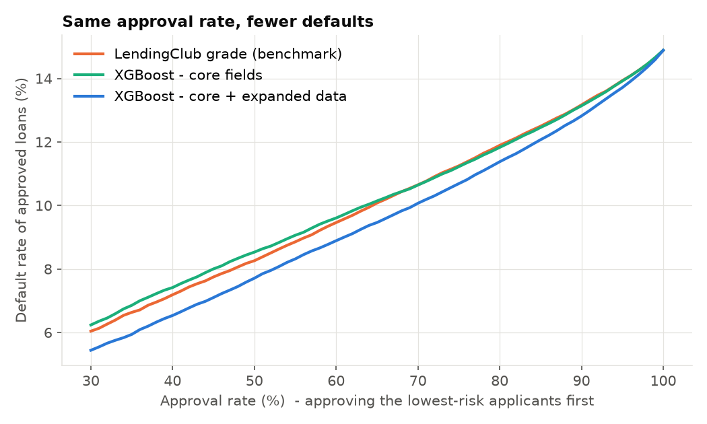
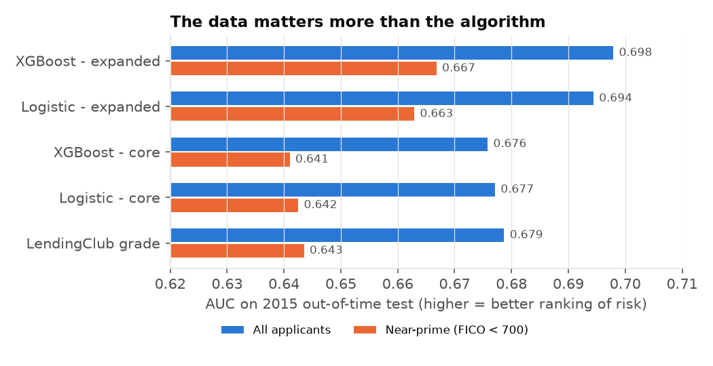
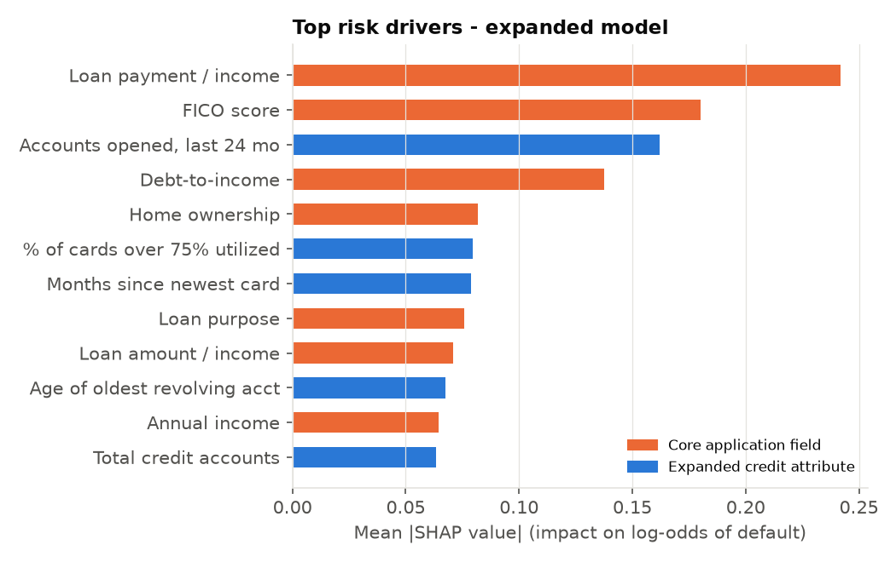
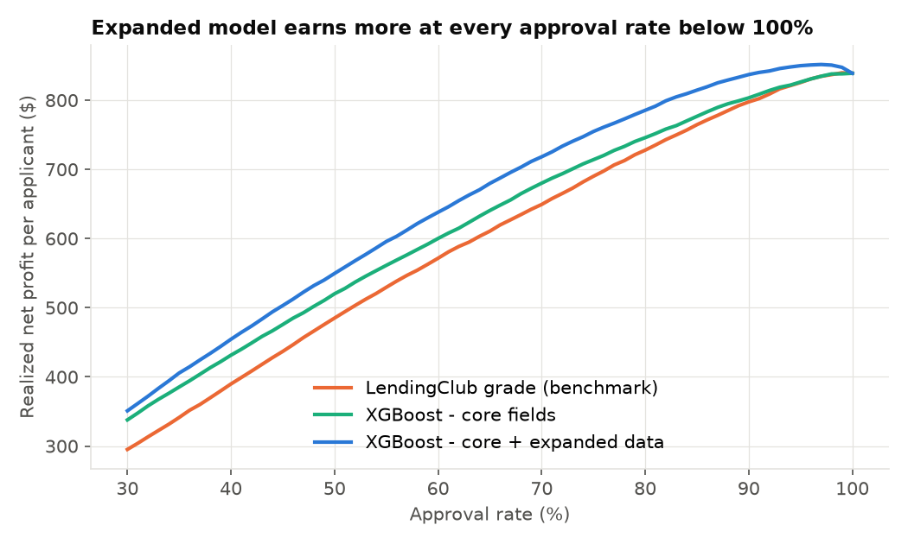
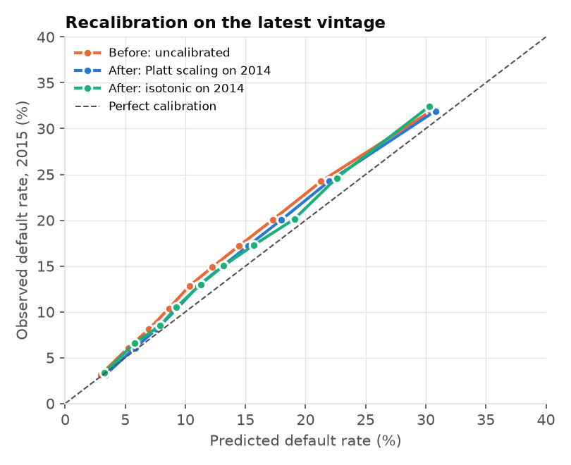
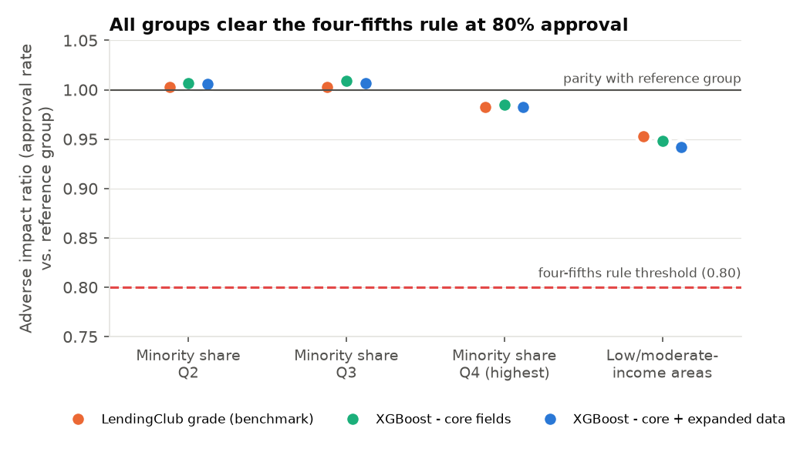
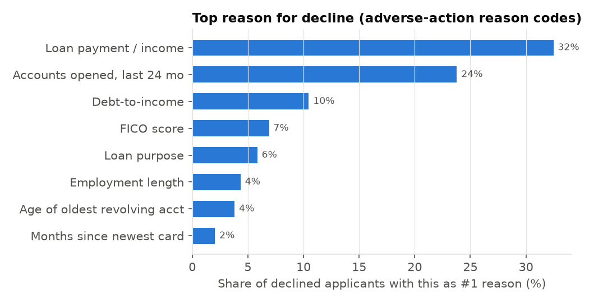

# Credit Risk Underwriting: Does More Data Beat a Better Algorithm?

Default-prediction models for unsecured personal loans, built on **589K LendingClub loans (2012–2015)** and judged the way a lender would: on an **out-of-time** test set, against the **incumbent risk grade**, in terms of **approvals, losses, and profit** rather than accuracy alone, and with a **fair-lending review** and **probability recalibration**.

> **Non-technical reader?** Start with the [one-page summary](SUMMARY.md).

## Executive summary

**Question:** For a consumer lender serving near-prime borrowers, is it worth adding credit-file attributes beyond the score (utilization patterns, recent credit-seeking, account age) to the underwriting model?

**Answer: yes. The new data drives the gain, not the algorithm.**

| | LendingClub grade (benchmark) | Best model (XGBoost + expanded data) |
|---|---|---|
| AUC, all applicants | 0.679 | **0.698** |
| AUC, near-prime (FICO < 700) | 0.643 | **0.667** |
| Default rate at 80% approval | 11.9% | **11.4%** (−4.3% relative) |
| Approval rate at the *same* default rate | 80.0% | **83.75%** |

Per 100,000 applicants, on loans the models never saw (2015 vintage):

- **+3,750 more approvals at the same risk level**, or +4,500 within the near-prime segment.
- **412 fewer defaults** at an unchanged 80% approval rate.
- **+$5.8M realized net profit** at an unchanged 80% approval rate (see the caveats below).

With only the core application fields, neither logistic regression nor XGBoost beats LendingClub's own grade (AUC 0.676–0.677 vs. 0.679). Adding the expanded attributes lifts both algorithms by about 0.02 AUC. The gain is largest for near-prime applicants, where a FICO score alone says the least.



## Approach

**Population.** 36-month loans issued 2012–2015 that reached a final outcome (Fully Paid or Charged Off). These vintages have essentially all run their course: only 147 loans (0.02%) were still open and were excluded. Using recent vintages would keep only the loans that ended *early*, which over-represents defaults and prepayments.

**Out-of-time split.** Train on the 2012–2014 vintages (306K loans, 13.3% default rate). Test on the 2015 vintage (283K loans, 14.9% default rate). This mirrors real deployment: a model built on past loans has to perform on future ones, even as the credit mix shifts.

**No leakage.** Only fields known at application time are model inputs. Post-origination fields (payments, recoveries, updated FICO, etc.) are excluded; total payments received are used only to measure each loan's realized profit, never as a feature.

**Feature sets.**
- *Core (10 features):* FICO, DTI, income, loan amount, employment length, payment-to-income, loan-to-income, home ownership, purpose, income verification. This is roughly what a score-driven underwriter sees.
- *Expanded (48 features):* core plus 38 credit-file attributes, including revolving and bankcard utilization, accounts opened recently, months since the last inquiry and the newest card, account age, delinquency history, and limits and balances. These stand in for evaluating a new data source.

**Models.** Logistic regression (quantile-normalized, L2-regularized), the standard baseline in credit scoring, and XGBoost (early-stopped). Both are fit on each feature set. LendingClub's sub-grade, its own priced risk model, is the benchmark.

**Business translation.** Rank applicants by predicted risk and approve the lowest-risk X%. Then measure the default rate and realized profit (total payments − amount funded) of the approved book, and compare policies at equal approval rate and at equal default rate.

## Results

| Model | AUC | KS | Near-prime AUC | Brier |
|---|---|---|---|---|
| LendingClub grade | 0.679 | 0.262 | 0.643 | – |
| Logistic, core | 0.677 | 0.261 | 0.642 | 0.1216 |
| XGBoost, core | 0.676 | 0.254 | 0.641 | 0.1211 |
| Logistic, expanded | 0.694 | 0.285 | 0.663 | 0.1197 |
| **XGBoost, expanded** | **0.698** | **0.285** | **0.667** | **0.1188** |



**What drives risk.** Payment burden relative to income and the FICO score lead. The third-strongest driver, ahead of DTI, is an expanded attribute: **number of accounts opened in the last 24 months**, a signal of recent credit-seeking. Card utilization concentration (share of cards over 75% utilized) and time since the newest card also rank in the top 7.



**Profit.** The expanded model earns more realized profit per applicant than both the benchmark and the core model at every approval rate below 100% (at 100% everyone is approved, so all scorers are equal).



## Probability calibration

Ranking risk well is not the same as predicting the *level* of risk correctly. Pricing, loss forecasts, and reserves depend on the level. To recalibrate without touching the test year, `src/calibrate.py` fits the expanded XGBoost on 2012–2013, calibrates on 2014 (the latest vintage a lender would have in hand), and evaluates on 2015.

| 2015 test (model fit on 2012–13) | Uncalibrated | Platt scaling | Isotonic |
|---|---|---|---|
| Expected calibration error (pct pts) | 1.90 | 1.32 | **1.29** |
| Brier score | 0.1199 | 0.1197 | 0.1197 |
| Mean predicted vs. observed default | 13.0% vs. 14.9% | 13.6% vs. 14.9% | 13.6% vs. 14.9% |

**Finding:** recalibration cuts calibration error by about a third, but a gap remains. The Platt slope is 0.96, so the model's risk *shape* is nearly right. The miss is a level shift: 2015 loans simply defaulted more than 2014 loans (14.9% vs. 13.7%). A calibrator fit only on past outcomes cannot anticipate that kind of shift. The production answer is ongoing monitoring of the gap between predicted and actual defaults by vintage, with periodic recalibration as early-delinquency data arrives, not a one-time fix.

Trade-off: holding out 2014 for calibration means the calibrated model trains on less recent data (AUC 0.688 vs. 0.698 for the main model). In practice the calibration is re-estimated on the most recent held-out outcomes each time the model is refit, and monitored in between.



## Fair-lending review

LendingClub data has no applicant race, ethnicity, or sex, and none of those are model inputs. To test for disparate impact, `src/fair_lending.py` uses an **area-level proxy**, similar to the geographic analysis used in redlining reviews (those typically use census tracts; LendingClub only discloses 3-digit ZIPs, so this is coarser). Each loan's 3-digit ZIP is joined to **Census ACS 2017–2021** data on minority population share and median household income (99.97% of loans matched).

**1. Adverse impact ratio (AIR).** This is each group's approval rate divided by the reference group's, under an 80% approval policy. A common rule of thumb, borrowed from the employment-law four-fifths rule, flags an AIR below 0.80. It is a screening heuristic, not a legal safe harbor.

| Group (reference) | LendingClub grade | XGBoost core | XGBoost expanded |
|---|---|---|---|
| Highest-minority quartile (vs. lowest) | 0.983 | 0.985 | 0.983 |
| Majority-minority areas (vs. other) | 0.988 | 0.991 | 0.988 |
| Low/moderate-income areas (vs. other) | 0.953 | 0.948 | **0.942** |

All groups clear the 0.80 screen by a wide margin. By area minority share, the new model's ratios are **essentially unchanged from the benchmark** (0.983 vs. 0.983; 0.988 vs. 0.988). It does slightly lower the LMI-area ratio versus the incumbent (0.942 vs. 0.953). That is the item to monitor and the starting point for a less-discriminatory-alternative search.



**2. Differential prediction.** The model does not over-predict risk for any group. Its default predictions run *below* actual defaults everywhere (the vintage drift above), and the gap is largest in highest-minority areas (13.9% predicted vs. 15.9% observed) and LMI areas (14.8% vs. 16.9%). Ranking quality (AUC) is consistent across minority-share quartiles (0.694–0.700) and slightly lower in LMI areas (0.689).

**3. Proxy screen.** No numeric model input is strongly correlated with area minority share: the highest absolute Spearman correlation is 0.14 (number of mortgage accounts). This is an area-level screen; it does not rule out individual-level proxy effects, and the categorical inputs (home ownership, purpose, income verification) were not screened. ZIP code and state are not model inputs.

**4. Adverse-action reason codes.** ECOA and Regulation B require specific reasons for a decline. For a sample of 20,000 declined applicants, the top risk-increasing SHAP contributions (XGBoost TreeSHAP) were used as reason codes. The most common principal reasons are payment-to-income (32%), accounts opened in the last 24 months (24%), and debt-to-income (10%). All are specific credit factors, and none is a demographic attribute.



## Limitations and next steps

1. **Approved-only population (selection bias).** LendingClub data contains only approved loans, so we never see how rejected applicants would have performed. A production model would need reject inference.
2. **Profit is simplified.** "Net profit" is total cash collected minus amount funded. It ignores cost of funds, servicing costs, and the time value of money, and it uses LendingClub's own pricing. Read it as directional.
3. **Vintage drift.** Even after recalibration, 2015 risk is under-predicted by about 1.3 percentage points (see *Probability calibration*). Next step: a monitoring dashboard of predicted vs. actual defaults by vintage and segment.
4. **"Expanded" ≠ truly alternative data.** These are credit-bureau attributes beyond the score, not cash-flow, rent, or utility data. The same framework (benchmark → challenger with new data → business and fairness impact) applies directly to evaluating real alternative data.
5. **Area-level fairness proxy.** Results describe *areas*, not individuals, and use 2017–2021 demographics for 2015 loans. A full review would use BISG (surname + geography) proxies and test less-discriminatory alternatives, starting with the LMI-area gap.

## Reproduce

```bash
python3.11 -m venv .venv && source .venv/bin/activate
pip install -r requirements.txt
./run.sh      # downloads data (~1.7 GB), then prepare -> train -> analyze -> calibrate -> fair lending (~2 min after download)
```

| File | Purpose |
|---|---|
| `src/prepare_data.py` | Population definition, leakage control, feature engineering |
| `src/train.py` | Out-of-time training and evaluation of all five scorers |
| `src/analyze.py` | Approval and profit policy analysis, SHAP drivers, charts |
| `src/calibrate.py` | Out-of-time recalibration (Platt, isotonic) on the latest vintage |
| `src/fair_lending.py` | Adverse impact ratios, differential prediction, proxy screen, reason codes |
| `SUMMARY.md` | One-page plain-language summary |
| `reports/metrics.json` | Model metrics (all applicants and near-prime) |
| `reports/business_impact.json` | Headline business numbers |
| `reports/calibration.json`, `reports/fair_lending.json` | Calibration and fair-lending results |

**Data:** LendingClub accepted loans 2007–2018Q4 (public; mirrored on Hugging Face as `codesignal/lending-club-loan-accepted`). U.S. Census Bureau ACS 2017–2021 5-year tables B03002 and B19013 (table-based summary file).
